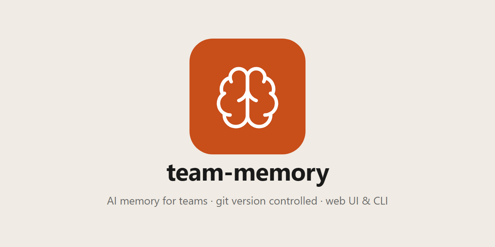

<div align="center">



# team-memory

**Shared memory for your team's AI assistants — learned in one repo, recalled in every repo.**

Plain Markdown in a GitHub repo you own. No servers, no database, no telemetry.

[](https://github.com/AndrewSkea/team-memory/actions/workflows/ci.yml)
[](LICENSE)

</div>

---

Alice spends an afternoon in `billing-service` discovering that the payments API rate-limits at 100 requests per second per key and that immediate retries make outages worse. A week later Bob opens Claude Code in `checkout-web` — a different repo, a different project — to write code that calls the same API. Before he's typed a word, his assistant already knows:

```
<team-memory>
Team knowledge about systems this workspace uses (from the shared memory repo acme/team-memory) …
- [20260927-155324-81d61d] Payments API rate-limits at 100 rps/key, returns HTTP 429 (incident; about payments-api; learned in acme/billing-service by alice, 1 week ago)
  Naive immediate retries cascade and worsen outages.
- [20260927-155326-88b5f0] Use jittered exponential backoff for payments API calls (decision; about payments-api; …)
</team-memory>
```

Nobody wrote a wiki page. Nobody tagged anything. Alice's session ended, team-memory pulled out what was worth keeping, and Bob's workspace mentions `PAYMENTS_API_URL`, which the team's catalogue knows is the payments API.

## How it works

1. **Capture.** When a Claude Code session ends (or compacts), a background worker reads the conversation and extracts durable knowledge: decisions, gotchas, how-tos, facts, conventions, incidents. Each becomes one Markdown file in your memory repo. Routine chatter is ignored — most sessions produce nothing, which is the point.
2. **Files are about systems, not repos.** Every memory records what it's *about* (`payments-api`, `kafka`, `postgres`) separately from where it was *learned*. A self-maintaining catalogue maps aliases — package names, env var names, spellings — to each system.
3. **Recall.** When a session starts, team-memory looks at what the workspace touches (dependencies, `.env` variable names, repo name) and injects the few memories about those systems. On each prompt it adds anything clearly relevant. It all runs locally against a mirror of the repo, so it adds no noticeable latency.
4. **Correction.** If a later session shows a memory is wrong, it gets superseded or retracted. Old knowledge stops being recalled; git keeps the history.

You choose how much of this happens automatically — see [capture modes](#capture-modes).

## Install

**macOS / Linux**
```sh
curl -LsSf https://raw.githubusercontent.com/AndrewSkea/team-memory/master/install.sh | sh
```

**Windows (PowerShell)**
```powershell
irm https://raw.githubusercontent.com/AndrewSkea/team-memory/master/install.ps1 | iex
```

You'll be asked three things:

1. **Memory repo** — `owner/name` of a GitHub repo for the team's memory (create an empty private one; team-memory sets it up).
2. **Access** — if you're logged in to the [GitHub CLI](https://cli.github.com), just press Enter to use that login. Otherwise paste a [fine-grained token](https://github.com/settings/personal-access-tokens/new) with *Contents: Read and write* on the memory repo.
3. **Capture mode** — press Enter for the recommended "AI decides".

That's it. The installer wires the hooks, MCP server and slash commands into Claude Code, then you use Claude Code as normal. Everyone on the team runs the same installer against the same repo.

Requirements: [Claude Code](https://claude.com/claude-code) (its `claude` CLI does the extraction, using your existing login — or set `ANTHROPIC_API_KEY`). No Python, Node or git needed.

Non-interactive (CI, dotfiles, MDM):
```sh
curl -LsSf …/install.sh | sh -s -- --repo acme/team-memory --use-gh --mode ai --yes
```

Check everything is working at any time:
```sh
team-memory-mcp doctor
```

## Capture modes

Each person picks how knowledge captured from *their* sessions is shared. Things you save deliberately are always published.

| Mode | What happens | Good for |
|---|---|---|
| `auto` | Everything the AI extracts is published immediately | Small, high-trust teams |
| `ai` *(default)* | Confident, clearly shareable items publish; anything uncertain waits for your review | Most people — near-zero effort, still safe |
| `review-timeout` | Everything waits for review, but publishes after a few days unless you reject it | Oversight without a growing backlog |
| `review` | Everything waits for your approval | Regulated or cautious teams |
| `manual` | No automatic capture | People who only want recall |

In `ai` mode an item waits for review if the AI is unsure, if it changes or contradicts an existing memory, if secrets had to be redacted from it, or if it's a type your team always reviews. In every mode, anything classified personal or sensitive is dropped, and secrets are redacted.

Nothing waiting for review leaves your machine. When something is waiting, your next session starts with a one-line nudge; review it with `/memory-review` in Claude Code, the **Review** tab in the web UI, or `team-memory-mcp pending`.

Change mode any time: `/memory-mode review`, the **Settings** tab, or `team-memory-mcp mode review`.

### Team policy

The memory repo's `.team-memory/policy.yml` sets defaults for everyone:

```yaml
default_mode: ai          # for people who haven't chosen
minimum_mode: auto        # least strict mode anyone may use (e.g. set to "review" to require approval)
review_timeout_days: 3
always_review_types: [decision]   # hold these even in ai mode
min_confidence: 0.75
outside_org: review       # sessions in repos outside your GitHub org: review | skip | allow
orgs: []                  # extra GitHub owners that count as "your org"
```

People can choose a stricter mode than the team minimum, never a looser one.

## Using it

Most of the time you do nothing: sessions are captured, relevant memories show up. When you want to be explicit:

| In Claude Code | |
|---|---|
| `/memory-search <query>` | Search team memory |
| `/memory-add <note>` | Save something now |
| `/memory-review` | Approve, edit or reject what's waiting |
| `/memory-mode [mode]` | Show or change your capture mode |
| *"remember that…"*, *"what does the team know about…"* | Claude uses the MCP tools (`recall`, `remember`, `supersede`, `forget`, …) |

**Web UI** — `http://127.0.0.1:7438` while Claude Code is running (or always, if you enabled the background service): save notes, decisions, meeting notes (drop an Outlook `.msg` invite to fill them in), search by text or system, review, see stats.

**CLI** — `team-memory-mcp search|add|pending|approve|reject|mode|sync|doctor`.

## The memory repo

```
memories/2026/09/20260927-155324-81d61d-payments-api-rate-limits.md
.team-memory/entities.yml     # systems + aliases (auto-maintained, edit freely)
.team-memory/policy.yml       # team capture policy
```

Each memory is a readable Markdown file:

```markdown
---
id: 20260927-155324-81d61d
title: Payments API rate-limits at 100 rps/key, returns HTTP 429
type: incident
summary: The payments API enforces 100 requests/second per API key and returns 429 beyond that.
about: [payments-api]
tags: [rate-limit, "429"]
author: alice
learned_in: acme/billing-service
source: session-end
created: 2026-09-27T15:53:24Z
confidence: 0.95
---

# Payments API rate-limits at 100 rps/key, returns HTTP 429

Immediate retries amplified the outage. Configured via PAYMENTS_API_URL.
```

Edit, delete or add files directly on GitHub — changes sync to everyone within minutes. One file per memory means teammates never conflict. Files from pre-1.0 versions (`GENERAL.md` etc.) stay searchable.

## How it compares

| | team-memory | Personal memory (CLAUDE.md, per-user memory tools) | Hosted memory services |
|---|---|---|---|
| Shared across a team | ✓ | — | Usually, per API key |
| Recalled across repositories by *system* | ✓ | — | Varies |
| Captured automatically from sessions | ✓, with per-user review modes | Some | Via SDK integration |
| Storage you own and can read | Plain Markdown in your GitHub repo | Local files | Vendor database |
| Review and audit trail | Git history + review queue | — | Varies |
| Infrastructure to run | None | None | Hosted or self-hosted service |

## Privacy and security

- Your memory repo is the only place memories go. Transcripts are sent only to Anthropic via your own Claude login, for extraction; they're never stored in the repo.
- Secrets are redacted before anything is saved; personal and sensitive items are never auto-published; review queues stay local.
- The web UI binds to `127.0.0.1` only, refuses cross-origin and DNS-rebinding requests, and never sees your token.
- No telemetry.

Details and limitations: [SECURITY.md](SECURITY.md).

## Upgrading from 0.x

Run the installer again. It replaces the old `Stop` hook (which never fired correctly) with `SessionStart`, `UserPromptSubmit`, `PreCompact` and `SessionEnd`, updates the MCP server and slash commands, and keeps your repo and token. Existing `GENERAL.md`-style files remain searchable; new memories are written one per file.

## Uninstall

```sh
team-memory-mcp uninstall          # remove hooks, MCP server, slash commands, service
team-memory-mcp uninstall --purge  # also delete local config (token) and data
```

Your memory repo is never touched.

## Contributing

See [CONTRIBUTING.md](CONTRIBUTING.md). `make test` runs everything; `make test-e2e` adds browser tests.

<div align="center">

[MIT License](LICENSE) · © Andrew Skea

</div>
